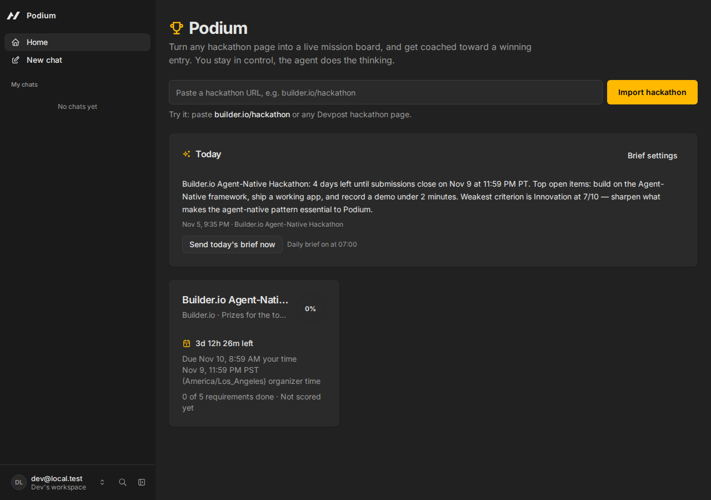
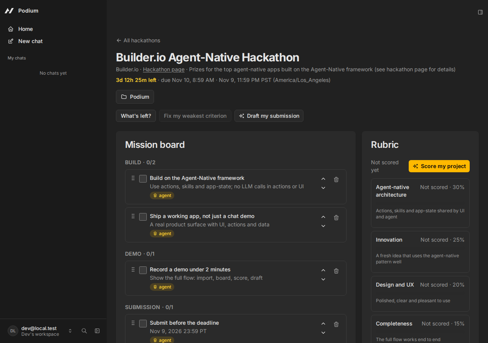

# Podium

**Turn any hackathon page into a live mission board, and get coached toward a winning entry.**

Live demo: **https://podium-82hb.onrender.com** · Source: this repo.

Try it with one click as a guest: hit **Try the demo** on the landing page, no email or sign-up. Guests land on a fresh demo board with the agent ready; if the board was last reset more than 10 minutes ago, guest entry resets it first, so one judge's ticks, scores and drafts never carry over to the next. **Reset demo** on the board restores it to its fresh state at any time.

Paste a hackathon URL and Podium's agent reads the rules, deadlines, requirements and rubric into a board you and the agent share. You tick things off by hand, the agent scores your project against the rubric, argues with you about the scores, and drafts your submission. Every morning it briefs you on what's left.




## Demo in under 2 minutes

1. Paste `builder.io/hackathon` in the import bar. The board fills in live.
2. Tick a requirement by hand, then ask the agent “what's left?” — it answers from the same board.
3. Save Podium itself as the project, hit **Score my project**, disagree with one score and watch it rescore, then apply the top fix.
4. Click **Draft submission**, then **Add to calendar** and watch the deadline appear with 24-hour and 2-hour alerts.

## Setup

```bash
npx --yes @agent-native/core@latest create podium --standalone --template chat
cd podium
corepack enable
pnpm install
pnpm dev
```

Choose **Continue as local dev** on the welcome screen. No account needed locally.

> If `pnpm install` fails on the native `node-pty` build, use `pnpm install --ignore-scripts`; only the in-app terminal is affected.

Seed the demo board (already seeded on first run):

```bash
pnpm action seed-podium
pnpm action list-hackathons
```

Connect an LLM in the app (Use Builder.io, Custom keys, or a `GOOGLE_GENERATIVE_AI_API_KEY` / `ANTHROPIC_API_KEY` / `OPENAI_API_KEY` in `.env`) so the agent can run the skills. Without a key the board, scoring UI and calendar export still work; the agent buttons will ask you to connect one. On the hosted app a deployment key covers every visitor, so the agent works with zero setup; the chat shows a small note recommending Builder.io when the active engine is not Builder.io.

Useful checks:

```bash
pnpm typecheck
pnpm agent-native:doctor
pnpm test
pnpm action whats-left --hackathonId <id>
pnpm action export-calendar --hackathonId <id>
```

## Architecture

Podium is built on the [Agent-Native framework](https://www.agent-native.com/docs/) (`@agent-native/core@0.224.0`, Chat template, standalone). It follows the framework's contract exactly:

- **One shared store.** All data lives in Postgres (local PGlite in dev) through Drizzle, defined in `server/db/schema.ts` and migrated by `server/plugins/db.ts`. The agent and the UI read and write the same rows, so a change on either side appears on the other instantly via live sync. No state in localStorage, no second copy.
- **One operation, every surface.** Every capability is a `defineAction` in `actions/` with a zod schema and an `outputSchema`. The agent calls it as a tool, the UI calls it through `useActionQuery` / `useActionMutation`, and the CLI calls it with `pnpm action <name>`. There are no custom API routes duplicating actions.
- **No AI inside actions or UI.** Actions are deterministic only: fetch, validate, save, compute. All reasoning (extracting rules, scoring, drafting) is done by the agent, guided by skills, which then saves results through actions. UI buttons that need AI call `sendToAgentChat` with the relevant ids as context.
- **The agent always knows what you're looking at.** The UI writes a `navigation` key to application state on every route change (including `hackathon` + `hackathonId`), and clicks write a `selection` key. The agent calls `view-screen` before acting, so “fix this” targets the item you selected.
- **Four areas per feature.** Every feature covers UI, action, skill / AGENTS.md entry, and app-state.

### Tables

| Table | What it holds |
| --- | --- |
| `hackathons` | Name, URL, organizer, organizer timezone, submission deadline, prize summary |
| `requirements` | Mission-board items: title, detail, category (`build` / `demo` / `submission` / `eligibility`), done, source (`agent` / `user`), status (`proposed` / `accepted`), order |
| `milestones` | Dated beats on the road to the deadline |
| `rubricCriteria` | Judging criteria with weights |
| `projects` | The entry: name, pitch, repo and demo URLs |
| `scores` | Per-criterion score (0–10), rationale, top fix, and the user's disagreement note |
| `drafts` | The submission draft |
| `briefs` | Saved daily briefs shown on the Today card |

### Actions

`fetch-hackathon-page` (fetch a page + its linked rules page, return cleaned text, no interpretation) · `save-hackathon` · `list-hackathons` · `get-hackathon` · `add-requirement` · `update-requirement` · `toggle-requirement` · `accept-requirement` · `delete-requirement` · `reorder-requirements` · `save-project` · `save-scores` (weighted total computed in code) · `add-score-note` · `save-draft` · `get-draft` · `whats-left` · `export-calendar` (builds a standard `.ics` in code, with 24h and 2h alerts) · `save-brief` · `get-briefs` · `get-brief-settings` · `save-brief-settings` · `seed-podium`.

### Skills

- `rules-extraction` — call `fetch-hackathon-page`, extract name, organizer, every deadline as an absolute timestamp with its zone, requirements by category, rubric with weights, prizes. Never invent anything; mark unclear items. Then `save-hackathon`.
- `rubric-coach` — read the project and rubric, score each criterion 0–10 honestly with a one-line rationale and the single highest-impact fix, respect any `userNote` when rescoring, then `save-scores`.
- `submission-writer` — write the submission description plus a “built during the event” disclosure from the board and project, then `save-draft`.
- `daily-brief` — check the brief settings, call `whats-left` for each active hackathon, write a short brief (time left, top three open items, weakest criterion), save it with `save-brief`.

### Reminders

- **Calendar export (ships).** `export-calendar` builds the `.ics` in code. The Timeline panel's **Add to calendar** button downloads it; it imports into Google Calendar, Apple Calendar and Outlook with no sign-in. The agent can call the same action: “put my deadlines in my calendar”.
- **Daily brief (ships).** Create a recurring job that runs the `daily-brief` skill every morning at the user's chosen time (default 07:00). The brief is saved with `save-brief` and shown as an in-app notification and a **Today** card on Home. Brief on/off and time live in the Today card's Brief settings. Jobs are DB-backed Agent Resources, not repo files — create the job in Settings › Automations (Scheduled, `0 7 * * *`), or ask the agent: “Create a scheduled task that runs the Podium daily-brief skill every morning at 7.”
- **Email / Google Calendar sync (stretch, deferred).** Not shipped. The daily brief is in-app only; live Google Calendar sync through OAuth was deliberately left out until the demo flow is flawless.

## Built during the hackathon

Podium started from the **Agent-Native Chat template** on **November 5, 2026** (scaffolded with `npx --yes @agent-native/core@latest create podium --standalone --template chat`, `@agent-native/core@0.224.0`), and was built during the Builder.io Agent-Native Hackathon.

- **Libraries used:** Agent-Native Core / AgentKit / Toolkit 0.224.0, React 19, React Router 8, Drizzle ORM, zod, Tailwind CSS v4, Radix/shadcn UI, TanStack Query, Sonner, Tabler Icons. No LLM SDK is imported in `actions/` or `app/` — the agent does all reasoning through the framework.
- **Built new for Podium:** the 8-table Postgres schema + migration, all 23 actions, the 4 skills, the AGENTS.md Podium section, the public landing page at `/` (real board screenshot in the hero, one-click guest access), the Home page (import bar, Today card, hackathon cards with countdowns and progress rings), the hackathon page (mission board with drag reorder and inline edit, rubric coach, timeline, project drawer, submission draft, Reset demo), calendar export, daily-brief settings and job, the chat-footer engine recommendation, dark-first theme with a single amber accent, and this README.
- **Kept from the template:** the chat shell, AgentSidebar, auth, live sync, application state, and the `hello` / `navigate` / `view-screen` framework actions (with `view-screen` extended for Podium's navigation and selection).
